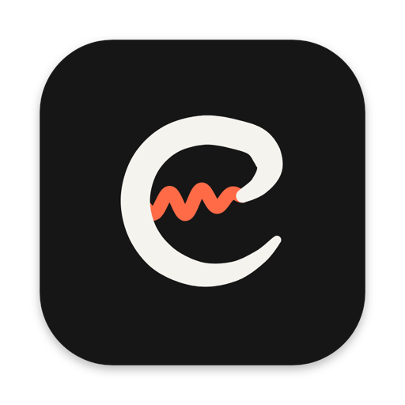
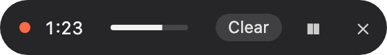
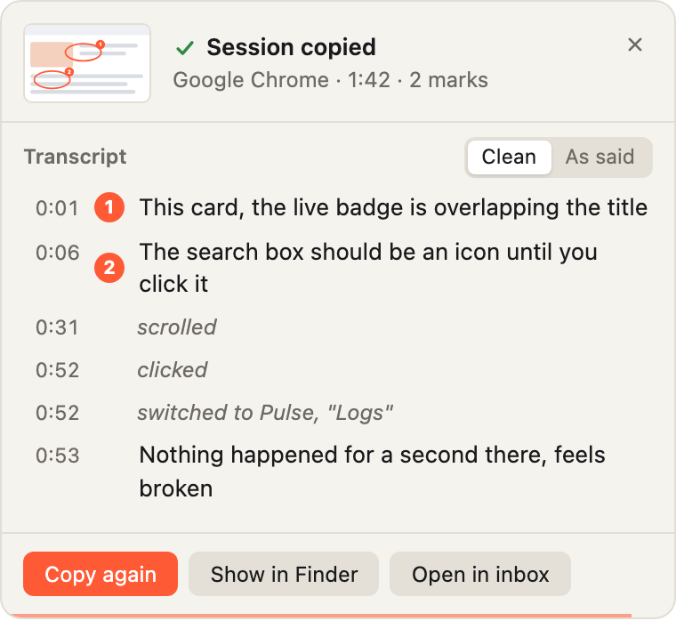
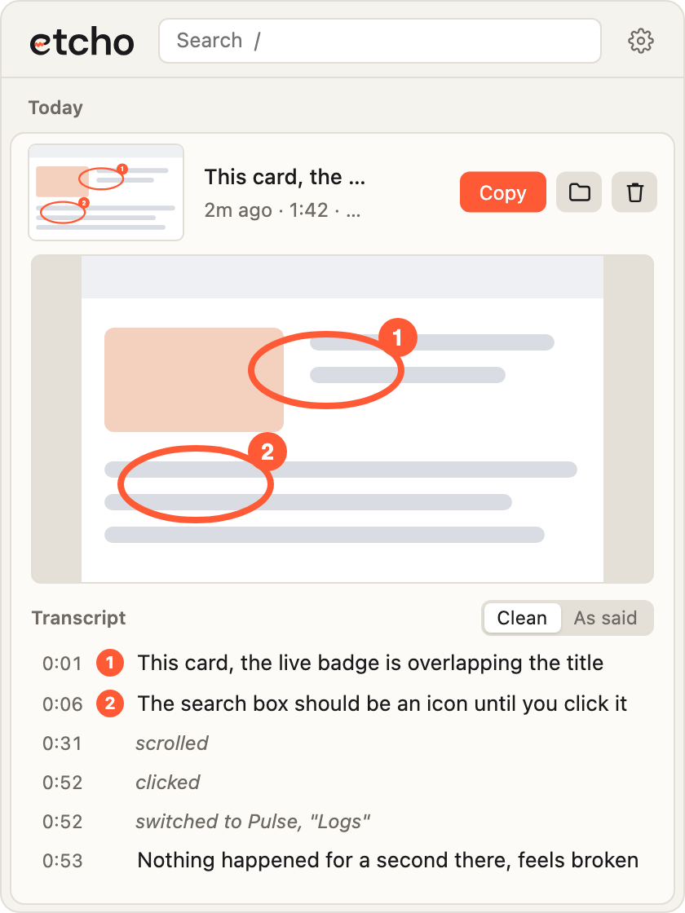
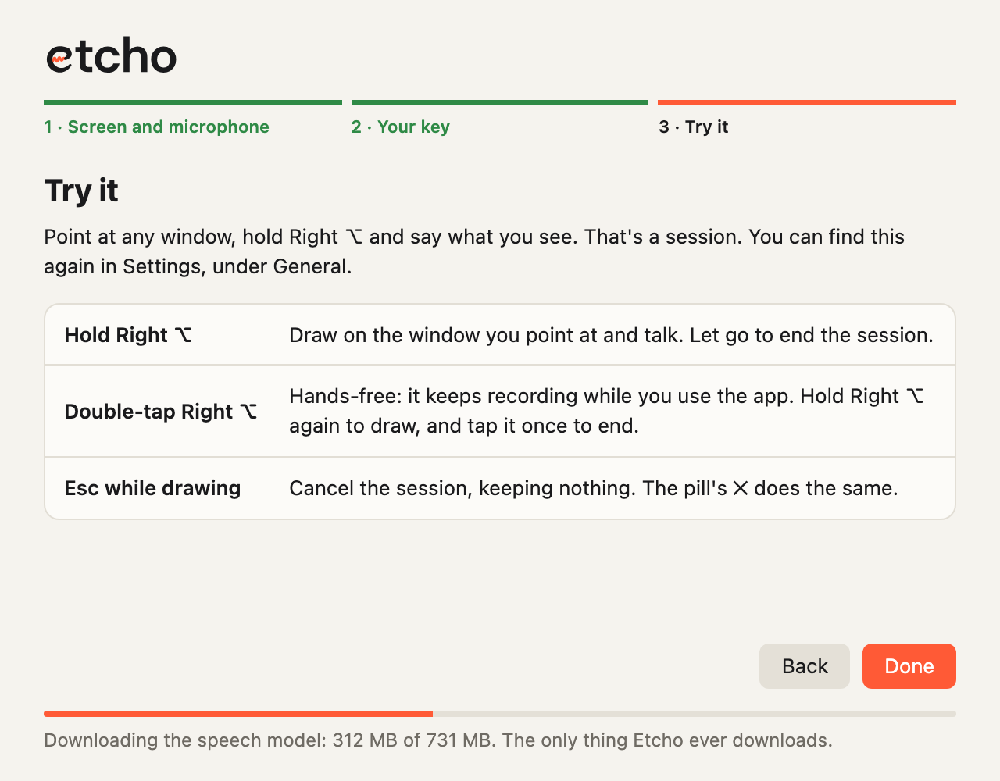

  

  <picture>
    <source media="(prefers-color-scheme: dark)" srcset="images/wordmark-dark.svg">
    
  </picture>

<b>Talk through what you see. Draw on what you mean.</b> 
Feedback on any window, ready to paste into any coding agent.

  

Apple Silicon &nbsp;·&nbsp; macOS 14 or later

---

## In short

1. **Hold Right ⌥** with any window in front: an app, a site, a design.
2. **Talk, and draw** circles, arrows or dots on what you're talking about. Each mark gets a number.
3. **Let go.** The session is on your clipboard. Paste it into your coding agent, an issue or a chat: what you said, tied to the marks you made, with the frames you were looking at.

  

While you talk, a small pill shows the time and your voice level.

<table>
  <tr>
    <td width="50%" valign="top">
      <picture>
        <source media="(prefers-color-scheme: dark)" srcset="images/review-dark.png">
        
      </picture>
      
<b>Copied the moment you let go.</b> A card shows what was heard, each sentence beside the mark it was about, with what you clicked and scrolled in between.

    </td>
    <td width="50%" valign="top">
      <picture>
        <source media="(prefers-color-scheme: dark)" srcset="images/inbox-dark.png">
        
      </picture>
      
<b>Every session, in the inbox.</b> Click the menu bar icon to search them, open one up, fix a word, or copy it again.

    </td>
  </tr>
</table>

## What a session holds

- **Your words**, transcribed on your Mac, cleaned of ums and false starts, each sentence tied to the mark it was about.
- **Numbered marks** on the window, so "this one" and "mark two" mean something to whoever reads it.
- **Frames** of the window, taken as you mark, click, scroll or switch windows, and a contact sheet with the marks drawn in.
- **What you did**: the clicks, scrolls and window switches in between, in order.

Hold the key for a quick note. Double-tap it for hands-free: Etcho keeps listening while you click through the app, and you hold the key again whenever you want to draw.

## Private by design

Nothing leaves your Mac. Etcho captures only the window you point at, and only during a session. Speech is transcribed locally. Its only download is the speech model, once, on first launch.

## Install

Download the `.dmg` from the [latest release](../../releases/latest) and follow the install steps under it. It takes a couple of minutes, plus the speech model's one-time download (730 MB).

  <picture>
    <source media="(prefers-color-scheme: dark)" srcset="images/setup-dark.png">
    
  </picture>

This is a tester build. Apple hasn't notarized it yet, so the first launch of each download needs **Open Anyway** in System Settings → Privacy & Security. The install steps walk through it.

## Feedback

[Open an issue](../../issues/new) with what happened and what you expected. Paste in an Etcho session if it helps. If something broke, attach the log: `~/Library/Logs/Etcho/etcho.log`.

To hear about new builds, click **Watch → Custom → Releases** at the top of this page.

## Credits

Speech is transcribed by NVIDIA Parakeet. Licensed by NVIDIA Corporation under the [NVIDIA Open Model License](https://www.nvidia.com/en-us/agreements/enterprise-software/nvidia-open-model-license/).
